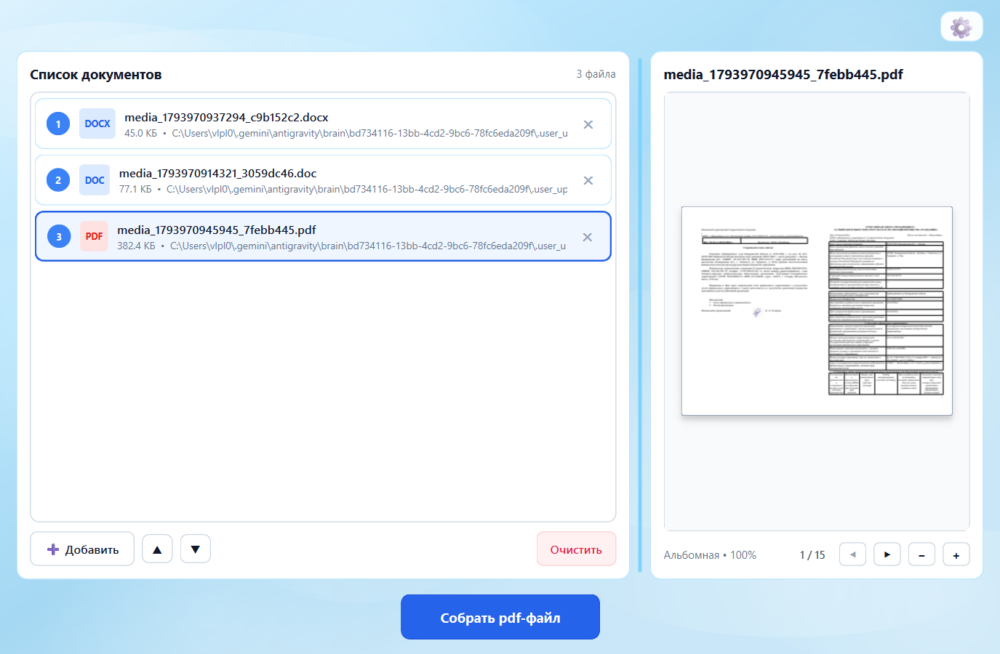
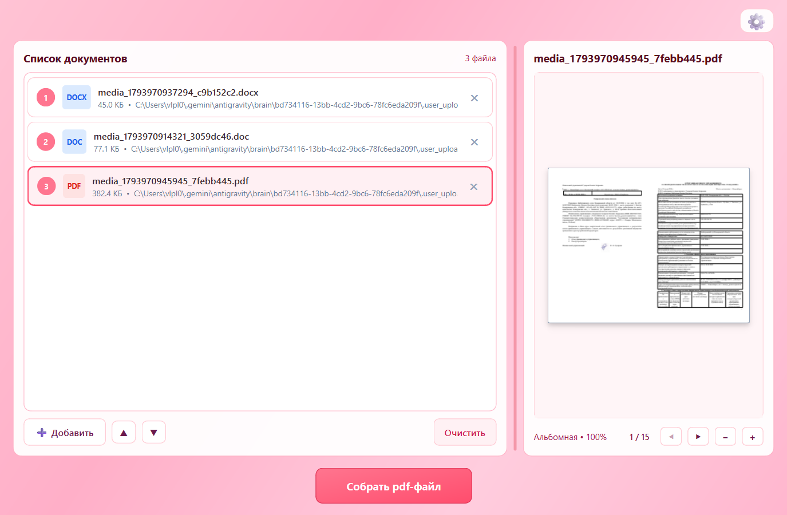
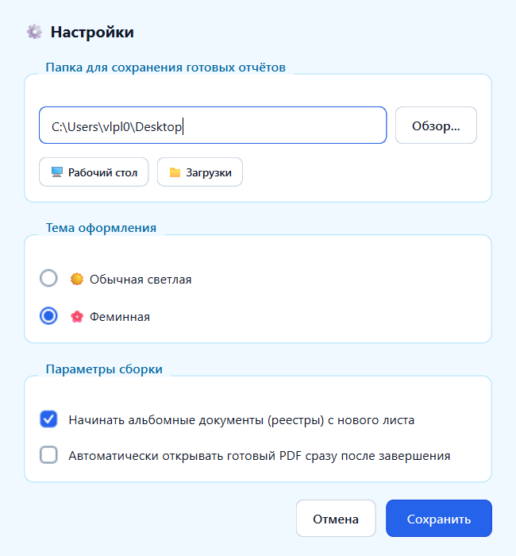

# Arbitrum (Мастер сборки отчетов АУ)

Десктопное приложение для автоматизации подготовки и объединения документов арбитражного управляющего в единый PDF-файл формата A4 (2 страницы на лист, альбомная ориентация).

## Назначение

При подаче квартальной отчетности арбитражного управляющего через электронные сервисы требуется строго определенная компоновка:
1. Порядок документов: Сопроводительное письмо -> Отчет арбитражного управляющего -> Реестр требований кредиторов.
2. Формат вывода: альбомный лист A4 (297 x 210 мм), на котором рядом размещаются две страницы исходных документов книжной ориентации либо отцентрированный альбомный лист (реестр).

Приложение автоматизирует конвертацию разнородных форматов (DOC, DOCX, PDF), приведение страниц к единому масштабу и сборку итогового документа.

## Основные возможности

- Загрузка файлов через системный проводник или перетаскиванием (Drag and Drop).
- Поддержка входных форматов `.doc`, `.docx`, `.pdf`.
- Изменение порядка файлов в списке перетаскиванием строк или кнопками перемещения.
- Удаление отдельных документов из очереди или полная очистка списка.
- Встроенный постраничный предварительный просмотр выбранного документа без открытия внешних программ.
- Навигация по страницам и масштабирование (zoom in / zoom out) в области предпросмотра.
- Модальное окно прогресса обработки с блокировкой интерфейса во избежание повторных нажатий.
- Диалог завершения с возможностью открыть собранный PDF или перейти в папку с файлом.
- Настройки рабочей директории сохранения (по умолчанию папка «Загрузки») с кнопками быстрого выбора.
- Выбор темы оформления интерфейса: стандартная светлая и альтернативная пастельная («Феминная»).

## Скриншоты интерфейса

### Главное окно (список документов и предпросмотр)


### Альтернативная тема оформления


### Окно параметров


## Технологический стек

- **Язык программирования:** Python 3.10+
- **Графический интерфейс:** PySide6 (Qt for Python 6.5+)
- **Рендеринг документов:** PySide6.QtPdf (QPdfDocument)
- **Обработка PDF:** pypdf
- **Конвертация Word в PDF:** Microsoft Word COM-автоматизация (`pywin32` / `pythoncom`)
- **Сборка в исполняемый файл:** PyInstaller

## Системные требования

- ОС: Windows 10 / Windows 11 (64-bit)
- Для обработки файлов `.doc` и `.docx` требуется установленный Microsoft Word (2010 или новее)

## Установка и запуск из исходного кода

1. Клонировать репозиторий:
   ```bash
   git clone https://github.com/YNGVLD11/Arbitrum.git
   cd Arbitrum
   ```

2. Установить зависимости:
   ```bash
   pip install -r requirements.txt
   ```

3. Запустить приложение:
   ```bash
   python main.py
   ```
   Или запустить файл `run.bat`.

## Сборка автономного EXE-файла

Для компиляции приложения в один `.exe` файл со встроенной иконкой выполните:
```bash
python build_exe.py
```
Собранный файл будет помещен в директорию `dist/Арбитрум.exe`.
