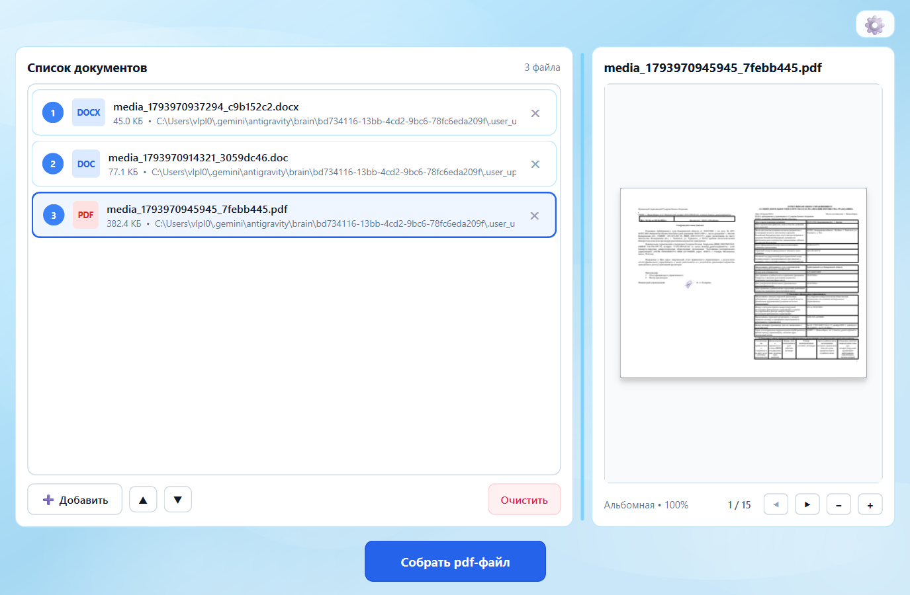
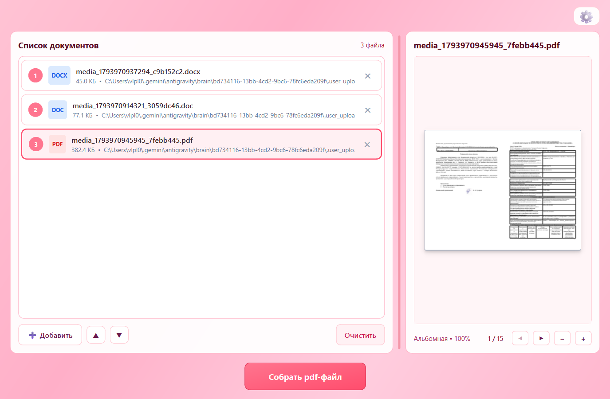
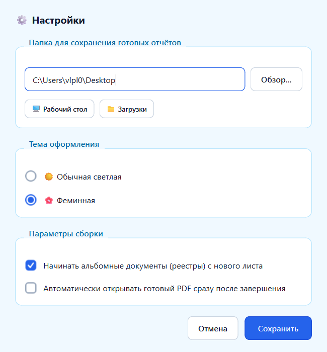

# Arbitrum (Арбитум) — Мастер сборки отчетов и генератор запросов АУ

Десктопное приложение для автоматизации рутинной работы арбитражного (финансового) управляющего:
1. **Сборка отчёта АУ** — объединение пакета документов в единый PDF- или Word-файл с настраиваемой компоновкой (альбомный разворот 2-на-лист или стандартное постраничное объединение).
2. **Генератор запросов** — автоматическое формирование официальных запросов в государственные ведомства, банки, работодателям и кредиторам по данным судебного акта.
3. **Ежедневник и календарь задач** — учет процессуальных сроков, привязка дел должников, ведение заметок и прикрепление рабочих документов.

---

## Возможности

### 1. Модуль «Сборка отчёта АУ»
- **Поддержка форматов:** импорт документов `.pdf`, `.docx`, `.doc`.
- **Drag & Drop:** добавление файлов перетаскиванием или через системный проводник.
- **Управление списком:** изменение порядка документов (перетаскивание строк списка или кнопки перемещения вверх/вниз), удаление отдельных файлов или полная очистка очереди.
- **Поворот страниц:** кнопка поворота на 90° прямо на карточке документа в очереди со мгновенным отображением в окне предварительного просмотра (исходный файл не перезаписывается).
- **Встроенный предпросмотр:** масштабирование (zoom in / zoom out) и постраничная навигация без необходимости открывать сторонние программы.
- **Режимы компоновки:**
  - *По одной странице на лист* — объединение страниц в исходном виде.
  - *По две страницы на листе* — формат А4 2-up (альбомная ориентация), оптимизированный для подачи квартальной отчетности в суд и Росреестр.
- **Выбор выходного формата:** экспорт итогового отчета в **PDF (`.pdf`)** или **Word (`.docx`)**.

### 2. Модуль «Генератор запросов»
- **Автоматический парсинг решения суда:** загрузка PDF-файла решения Арбитражного суда с автоматическим извлечением реквизитов дела, суда, должника (ФИО, паспорт, СНИЛС, ИНН, адрес, дата и место рождения, дата принятия заявления) и сведений о браке.
- **Интеллектуальное склонение:** автоматическое приведение ФИО в родительный и творительный падежи с помощью морфологического анализатора `pymorphy3` для юридически выверенных формулировок.
- **20 шаблонов запросов и уведомлений:** компактный двухколоночный список с кнопками быстрого выбора («Выбрать все» / «Снять выделение»):
  - Банки (уведомление-запрос по кредиторам)
  - Работодателю (справка 2-НДФЛ за 3 года с начала календарного года и реквизиты спецсчета)
  - Уведомление кредиторам
  - Администрация
  - БТИ
  - ГИБДД
  - ГИМС
  - Гостехнадзор
  - ЕГРН (Росреестр сокращенный)
  - ЗАГС
  - ИФНС
  - Росавиация
  - Росгвардия
  - Росимущество
  - Роспатент
  - Росреестр
  - ФССП (Служба судебных приставов)
  - СФР (Социальный фонд)
  - Должнику / Супругу
  - УВМ (МВД по вопросам миграции)
- **Удобная форма редактирования:** реквизиты дела, суда, должника, финансового управляющего, супруга, работодателя и кредиторов с всплывающими подсказками (tooltips) по каждому полю.
- **Индивидуальная подстановка данных:** точная расстановка реквизитов, автоматическое проставление сегодняшней системной даты в исходящем номере, расчет 3-летнего периода и размещение факсимиле подписи.
- **Пакетная генерация:** сохранение сформированных документов в отдельную папку по ФИО должника с диалогом быстрого перехода к папке с файлами.

### 3. Модуль «Ежедневник и календарь»
- **Календарное планирование:** навигация по дням, быстрый переход к сегодняшней дате, выбор даты через всплывающий календарь.
- **Картотека должников:** выбор должника из базы данных с отображением номера дела.
- **Задачи и чек-листы:** добавление и отметка выполнения задач на выбранный день.
- **Заметки:** текстовый блок для оперативных записей по процессуальным действиям.
- **Прикрепление файлов:** перетаскивание рабочих файлов (PDF, Word, сканы) с возможностью прямой отправки в модуль «Сборка отчёта».

### 4. Общие функции и интерфейс
- **Темы оформления:** светлая тема («Обычная светлая») и элегантная пастельная тема («Феминная»).
- **Рабочая директория:** выбор папки сохранения с быстрыми ссылками («Рабочий стол», «Загрузки»).
- **Интерактивный разделитель (Splitter):** плавная регулировка соотношения ширины очереди документов и панели предпросмотра.

---

## Скриншоты интерфейса

### Модуль 1: Сборка отчёта АУ


### Модуль 2: Генератор запросов


### Альтернативная тема оформления («Феминная»)


### Окно параметров


---

## Технологический стек

- **Язык программирования:** Python 3.10+
- **Графический интерфейс:** PySide6 (Qt for Python 6.5+)
- **Рендеринг документов:** PySide6.QtPdf (QPdfDocument)
- **Обработка PDF:** pypdf, pdfplumber
- **Генерация и обработка Word:** python-docx, Microsoft Word COM-автоматизация (`pywin32` / `pythoncom`)
- **Морфологический анализ и склонение:** pymorphy3, pymorphy3-dicts-ru
- **Компиляция приложения:** PyInstaller

---

## Системные требования

- **ОС:** Windows 10 / Windows 11 (64-bit)
- Для прямой конвертации исходных файлов `.doc` в модуле сборки отчетов требуется установленный Microsoft Word (2010 или новее). Для генерации запросов в `.docx` наличие Word не обязательно.

---

## Установка и запуск из исходного кода

1. Клонировать репозиторий:
   ```bash
   git clone https://github.com/YNGVLD11/Arbitrum.git
   cd Arbitrum
   ```

2. Установить зависимости:
   ```bash
   pip install -r requirements.txt
   ```

3. Запустить приложение:
   ```bash
   python main.py
   ```
   Или использовать готовый скрипт `run.bat`.

---

## Сборка автономного EXE-файла

Для компиляции приложения в единый исполняемый `.exe` файл со встроенными зависимостями и иконкой:
```bash
python build_exe.py
```
Собранный файл сохраняется в `dist/Арбитрум.exe`.
