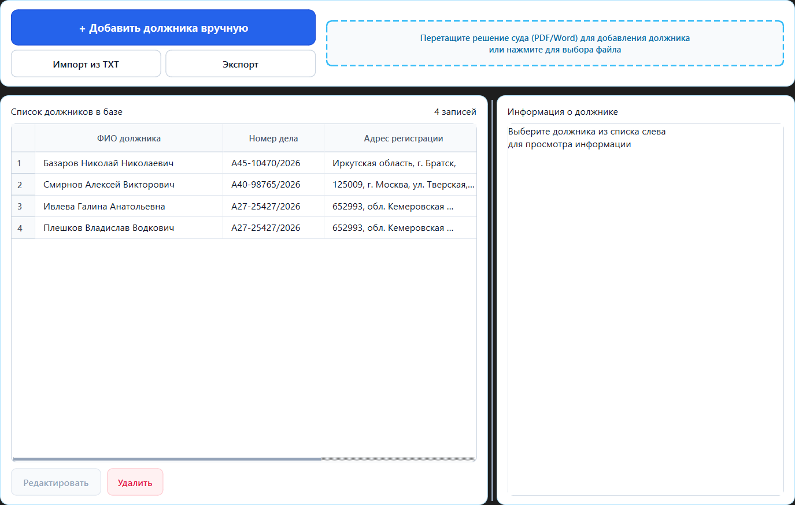
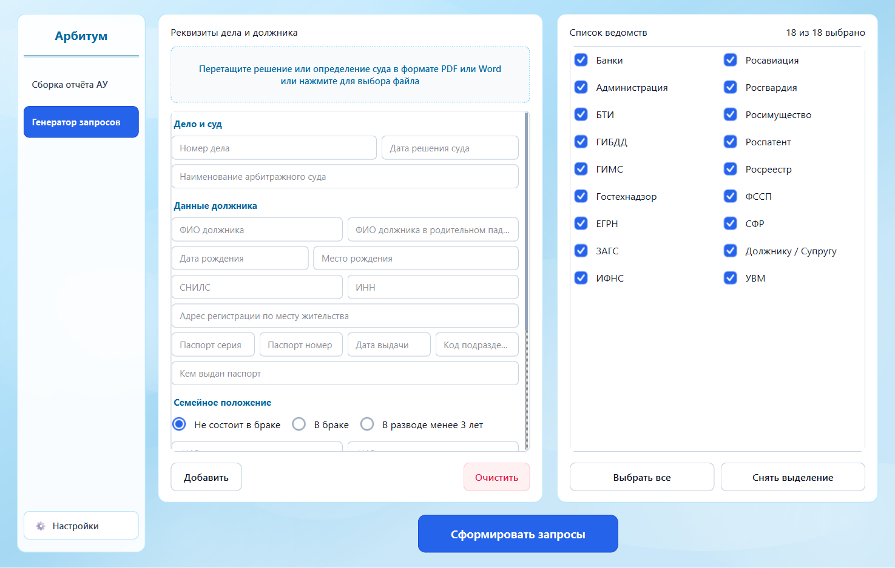
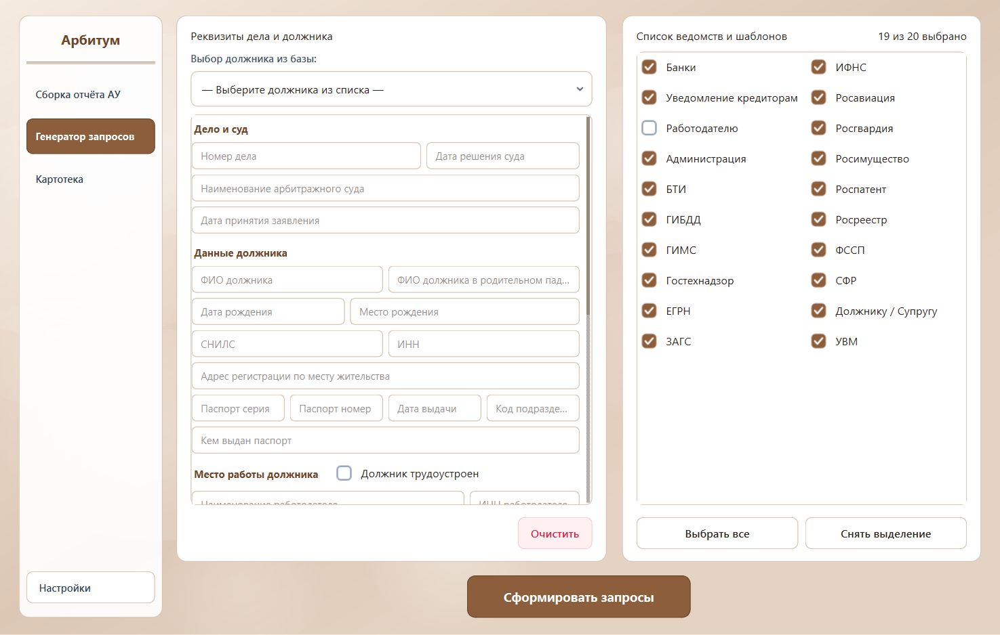
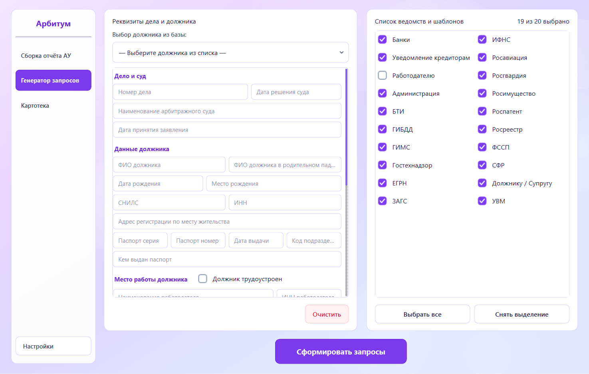
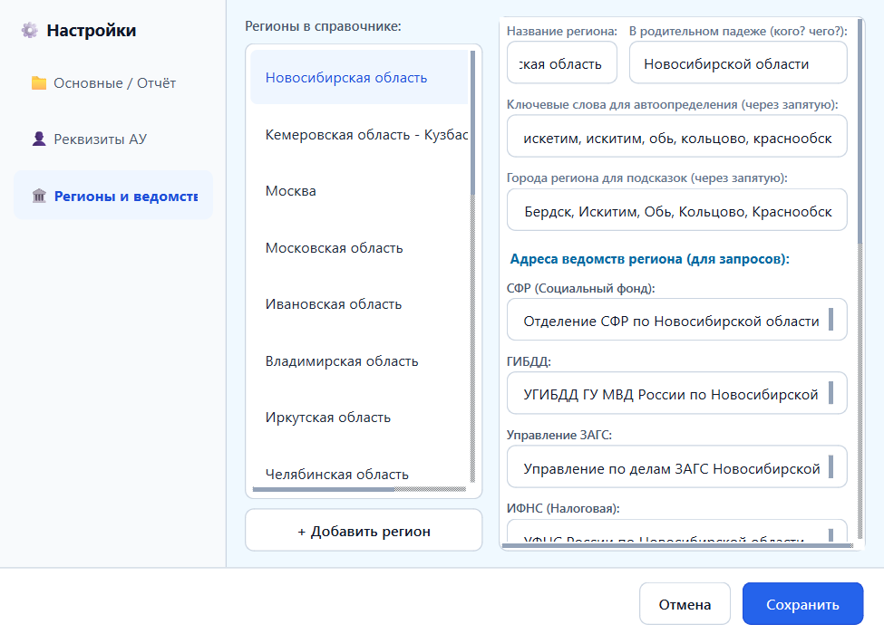

<div align="center">
  
  <h1>Arbitrum (Арбитрум)</h1>
  <p><b>Автоматизированное рабочее место арбитражного (финансового) управляющего</b></p>
  <p>Сборка судебных отчетов • Генератор ведомственных запросов • Картотека должников</p>
</div>

---

## Описание проекта

**Arbitrum (Арбитрум)** — современное десктопное приложение для комплексной автоматизации рутинной правовой и организационной работы арбитражного (финансового) управляющего. 

Приложение объединяет в одном окне три ключевых рабочих модуля:
1. **Сборка отчёта АУ** — объединение пакета документов в единый PDF- или Word-файл с гибкой компоновкой (альбомный разворот 2-на-лист или стандартное постраничное объединение).
2. **Генератор запросов** — мгновенное формирование полного комплекта официальных запросов в государственные органы, банки, работодателям и кредиторам на основании судебного акта.
3. **Картотека должников** — встроенная база данных дел и должников (SQLite) с возможностью быстрого импорта решений суда, ручного редактирования, текстового обмена данными и прямой передачи сведений в Генератор запросов.

---

## Возможности приложения

### 1. Модуль «Сборка отчёта АУ»
- **Поддержка форматов:** импорт документов `.pdf`, `.docx`, `.doc`.
- **Drag & Drop:** добавление файлов простым перетаскиванием или через проводник.
- **Управление очередью:** изменение порядка документов (drag-and-drop в списке или кнопки вверх/вниз), удаление отдельных файлов и полная очистка.
- **Поворот страниц на лету:** кнопка поворота на 90° прямо на карточке файла в очереди с мгновенным обновлением во встроенном просмотрщике.
- **Встроенный просмотр:** масштабирование (zoom in / zoom out) и быстрая навигация без необходимости запуска сторонних PDF-ридеров.
- **Режимы компоновки:**
  - *По одной странице на лист* — объединение страниц в оригинальном масштабе.
  - *По две страницы на листе* — формат А4 2-up (альбомная ориентация), оптимизированный для подачи квартальной отчетности в суд и Росреестр.
- **Выходной формат:** экспорт готового сборного отчета в **PDF (`.pdf`)** или **Word (`.docx`)**.

### 2. Модуль «Генератор запросов»
- **Выбор должника из базы:** быстрый выбор из выпадающего списка сохраненных дел Картотеки.
- **Автоматический парсинг решения суда:** интеллектуальное извлечение реквизитов арбитражного дела, суда, должника (ФИО, паспорт, СНИЛС, ИНН, адрес, дата и место рождения, дата принятия заявления к производству) и сведений о браке из PDF-файла судебного акта.
- **Автоматическое морфологическое склонение:** приведение ФИО должника и супруга в родительный и творительный падежи (`pymorphy3`).
- **20 шаблонов запросов и уведомлений:** компактный список с быстрым выбором («Выбрать все» / «Снять выделение»):
  - Банки (уведомление-запрос по кредиторам)
  - Работодателю (справка 2-НДФЛ за 3 года и реквизиты спецсчета)
  - Уведомление кредиторам
  - СФР (Социальный фонд)
  - ГИБДД
  - Управление ЗАГС
  - ИФНС (Налоговая инспекция)
  - ФССП (Судебные приставы)
  - Росреестр и ЕГРН (сокращенный)
  - Росимущество
  - Гостехнадзор
  - ГИМС МЧС
  - Росгвардия
  - Администрация города / поселения
  - БТИ / Центр кадастровой оценки
  - Роспатент
  - Росавиация
  - УВМ (МВД по вопросам миграции)
  - Должнику / Супругу
- **Умное автоопределение адресов ведомств:** автоматическая подстановка актуальных адресов территориальных органов по региону проживания должника из настраиваемого справочника `assets/regions.json`.
- **Автоматическая нумерация и датирование:** простановка сегодняшней даты, генерация исходящих номеров и автоматический расчет периода для справки о доходах (2-НДФЛ).
- **Пакетная выгрузка:** сохранение комплекта документов в персональную папку должника с диалогом открытия результата.

### 3. Модуль «Картотека»
- **Локальная база данных SQLite:** надежное хранение карточек должников, номеров дел, паспортных данных, работодателей, кредиторов и сведений о супругах в локальной БД `data/arbitrum.db`.
- **Быстрое создание должника:**
  - Автоматическое распознавание через drag-and-drop PDF-решения суда.
  - Ручной ввод через модальное окно с валидацией и всплывающими подсказками.
- **Интерактивная таблица:**
  - Настраиваемая ширина колонок.
  - Построчное выделение записи целиком с подсветкой при наведении.
  - Автоматический скролл и фокусировка на созданной/отредактированной записи.
- **Многовкладочная правая панель управления:**
  - **Вкладка «Реквизиты»:** полный сводный просмотр всех реквизитов должника и кнопка формирования **Заявления-согласия АУ в суд и СРО** (`.docx` по официальному шаблону с подписью).
  - **Вкладка «Сроки»:** умный автоматический расчет дедлайнов (публикация в ЕФРСБ, заявка в «Коммерсантъ», отправка запросов в ведомства) с автоскрытием просроченных этапов и кнопкой пакетной генерации писем в ЕФРСБ и «Коммерсантъ».
  - **Вкладка «Скрипт-сообщение»:** интеллектуальный генератор сообщений клиенту с переключателем сценариев (*«Первый контакт»* и *«Определение суда»* с контрольным сроком за 5 дней до СЗ), настраиваемыми чекбоксами документов и быстрым копированием в буфер обмена.
- **Импорт и экспорт данных:**
  - Экспорт карточки должника в форматированный текстовый файл `.txt`.
  - Пакетный импорт данных из ранее сохраненных текстовых карточек.

### 4. Вкладки и персонализация в Настройках
- **Структурированное боковое меню параметров:**
  1. *Основные / Отчёт:* выбор рабочей папки, формата файла, режима компоновки и темы оформления.
  2. *Реквизиты АУ:* постоянные реквизиты управляющего (ФИО, телефон, email, ИНН, СНИЛС, почтовый адрес), автоматически подставляемые во все запросы, согласия и публикации.
  3. *Регионы и ведомства:* интерактивный редактор справочника субъектов РФ, ключевых слов автоопределения и точных адресов территориальных органов с адаптивной высотой текстовых полей.
  4. *Обновление программы:* проверка и автоматическая удаленная загрузка новых версий приложения прямо из GitHub Releases.
- **Встроенный шрифт Inter:** единая современная типографика без зависимости от системных шрифтов Windows.
- **4 темы оформления интерфейса:**
  - ☀️ **Обычная светлая** — строгая сине-белая бизнес-палитра.
  - 🌸 **Феминная** — нежная розовая палитра с мягкими градиентами.
  - ☕ **Капучино** — теплая кофейно-древесная палитра.
  - 🪻 **Лаванда** — мягкая лавандово-фиолетовая эстетичная палитра.

---

## Скриншоты интерфейса

### Картотека должников


### Сборка отчёта АУ


### Генератор запросов


### Новые темы оформления («Капучино» и «Лаванда»)
| Тема «Капучино» | Тема «Лаванда» |
|:---:|:---:|
|  |  |

### Окно настроек (вкладки со справочником регионов)


---

## Технологический стек

- **Язык разработки:** Python 3.10+
- **Графический интерфейс:** PySide6 (Qt for Python 6.5+)
- **База данных:** SQLite 3 (встроенная локальная реляционная БД)
- **Рендеринг документов:** PySide6.QtPdf (QPdfDocument)
- **Обработка PDF:** pypdf, pdfplumber
- **Генерация документов Word:** python-docx, Microsoft Word COM API (`pywin32` / `pythoncom`)
- **Лингвистический анализ и склонение:** pymorphy3, pymorphy3-dicts-ru
- **Сборка дистрибутива:** PyInstaller

---

## Системные требования

- **Операционная система:** Windows 10 / Windows 11 (64-bit)
- Для прямой конвертации исходных файлов `.doc` в модуле сборки отчетов требуется установленный Microsoft Word (2010 или новее). Для работы Картотеки и генерации запросов в `.docx` наличие Word не требуется.

---

## Установка и запуск из исходного кода

1. Клонировать репозиторий:
   ```bash
   git clone https://github.com/YNGVLD11/Arbitrum.git
   cd Arbitrum
   ```

2. Установить зависимости:
   ```bash
   pip install -r requirements.txt
   ```

3. Запустить приложение:
   ```bash
   python main.py
   ```
   Либо дважды кликнуть на скрипт `run.bat`.

---

## Сборка автономного EXE-файла

Для компиляции приложения в единый исполняемый `.exe` файл со встроенными зависимостями и ресурсами:
```bash
python build_exe.py
```
Собранный исполняемый файл сохраняется в каталоге `dist/Арбитрум.exe`.
